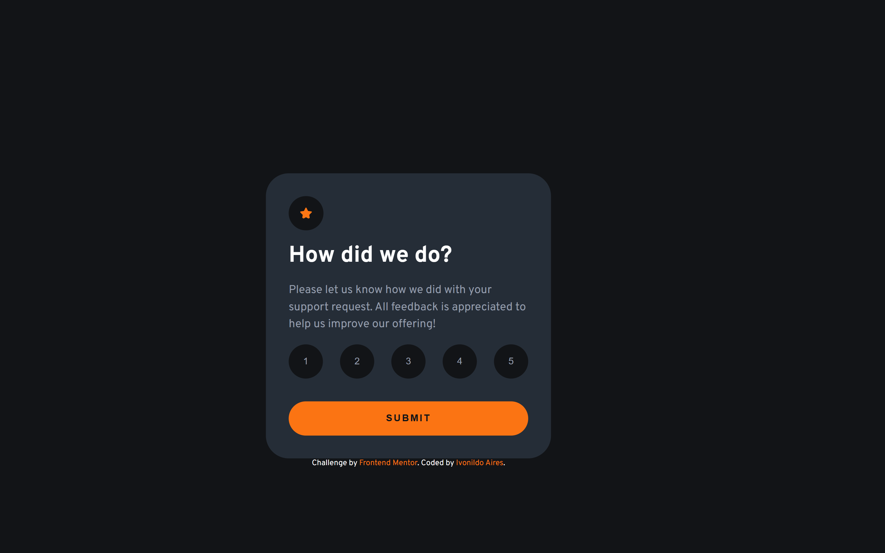
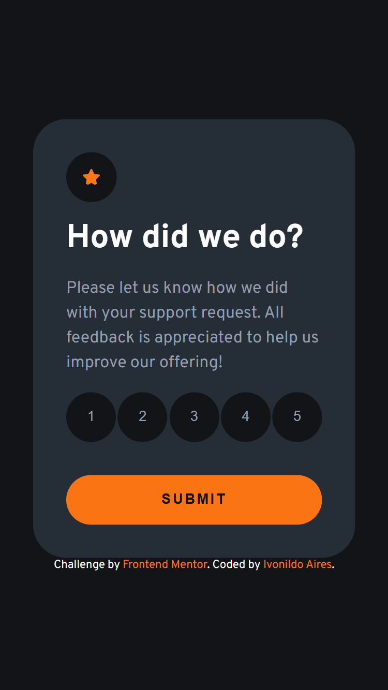
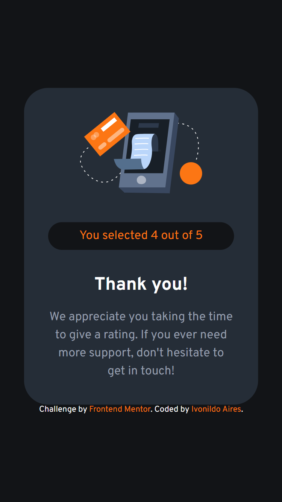

# Frontend Mentor - Interactive rating component solution

  This is a solution to the [Interactive rating component challenge on Frontend Mentor](https://www.frontendmentor.io/challenges/interactive-rating-component-koxpeBUmI). Frontend Mentor challenges help you improve your coding skills by building realistic projects. 

## Table of contents

- [Overview](#overview)
  - [The challenge](#the-challenge)
  - [Screenshot](#screenshot)
  - [Links](#links)
- [My process](#my-process)
  - [Built with](#built-with)
  - [What I learned](#what-i-learned)
  - [Continued development](#continued-development)
  - [Useful resources](#useful-resources)
  - [AI Collaboration](#ai-collaboration)
- [Author](#author)


## Overview

### The challenge

Users should be able to:

- View the optimal layout for the app depending on their device's screen size
- See hover states for all interactive elements on the page
- Select and submit a number rating
- See the "Thank you" card state after submitting a rating

### Screenshot

#### Desktop - Rating

#### Desktop - Thank you

#### Mobile - Rating

#### Mobile - Thank you



### Links

- Solution URL: [Frontend Mentor](https://www.frontendmentor.io/solutions/responsive-interactive-rating-component-with-vanilla-javascript-Nu_JHOeYFv)
- Live Site URL: [GitHub Pages](https://ivonildo-aires.github.io/interactive-rating-component/)
- Repository URL: [GitHub](https://github.com/Ivonildo-Aires/interactive-rating-component)

## My process

### Built with

- Semantic HTML5 markup
- CSS3
- CSS custom properties
- Flexbox
- Responsive design
- Vanilla JavaScript
- DOM manipulation
- Event listeners
- BEM-inspired naming convention


### What I learned

During the development of this project, I improved my
understanding of the BEM methodology, CSS custom properties,
responsive design, and hover effects.

I also improved my DOM manipulation skills. I learned how
to use the `display: none` property combined with adding
and removing CSS classes through JavaScript to switch
between different cards.

My biggest challenge was breaking problems into smaller
tasks and organizing my code into independent and reusable
functions.

Additionally, I gained a better understanding of semantic
HTML elements and how HTML, CSS, and JavaScript work
together to create interactive interfaces.


One of my favorite CSS techniques was using a class
to hide a card:

```css
.acknowledgment-hidden {
    display: none;
}
```

With JavaScript, I learned how to toggle the visibility
of the cards by adding and removing CSS classes, as well
as dynamically displaying the selected rating:

```js
if (result !== undefined) {
    acknowledgmentControl.classList.remove("acknowledgment-hidden");
    assessmentControl.classList.add("acknowledgment-hidden");
    note.innerText = `You selected ${result} out of 5`;
}
```

### Continued development

In future projects, I intend to improve my ability to break
complex problems into smaller tasks and develop more
reusable functions.

I also want to improve my responsive design skills and
code organization, avoiding repetition and writing
cleaner code.

Additionally, I plan to deepen my understanding of DOM
manipulation and event handling while becoming more
independent in solving problems.

### Useful resources

- [OneBitCode](https://onebitcode.com/) - Helped me review programming concepts and strengthen my JavaScript skills.

- [Google Fonts](https://fonts.google.com/) - Used to import the Overpass font.

- [MDN Web Docs](https://developer.mozilla.org/) - Used as a reference for HTML, CSS, and JavaScript.

- [W3Schools](https://www.w3schools.com/) - Helped me review programming concepts and practical examples.

- [Google](https://www.google.com/) - Used to research technical questions and find solutions.

- [GIMP](https://www.gimp.org/) - Used for image editing and processing.

- [Curso em Vídeo](https://www.cursoemvideo.com/) - Helped me strengthen my web development fundamentals.

### AI Collaboration

I decided to use ChatGPT as a learning assistant to clarify
questions and better understand concepts that I still need
to improve. This helped me discover different approaches
to solving problems.

AI assisted me by providing explanations and guidance on
how to apply each concept, without providing ready-made
coding solutions.

Since my main goal is to learn programming fundamentals
and deepen my knowledge, I chose to develop my own
solutions.

This learning methodology broadened my understanding of
programming concepts and helped me develop new ways of
thinking and solving problems.

## Author

- Name: Ivonildo Aires
- GitHub - [@Ivonildo-Aires](https://github.com/Ivonildo-Aires)
- Frontend Mentor - [@Ivonildo-Aires](https://www.frontendmentor.io/profile/Ivonildo-Aires)
- LinkedIn - [Ivonildo Aires](https://www.linkedin.com/in/ivonildo-aires)


